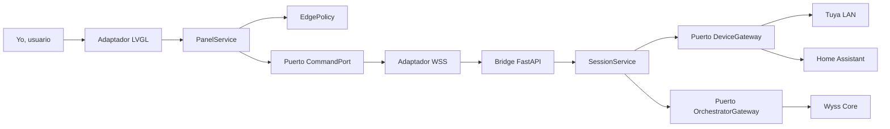
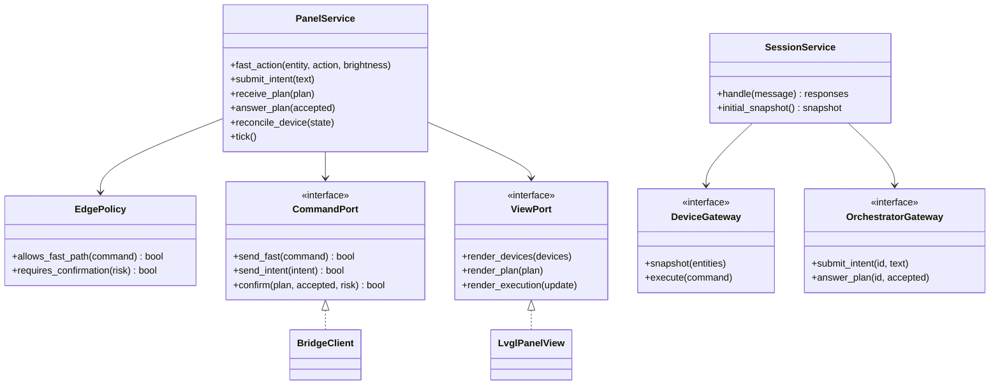
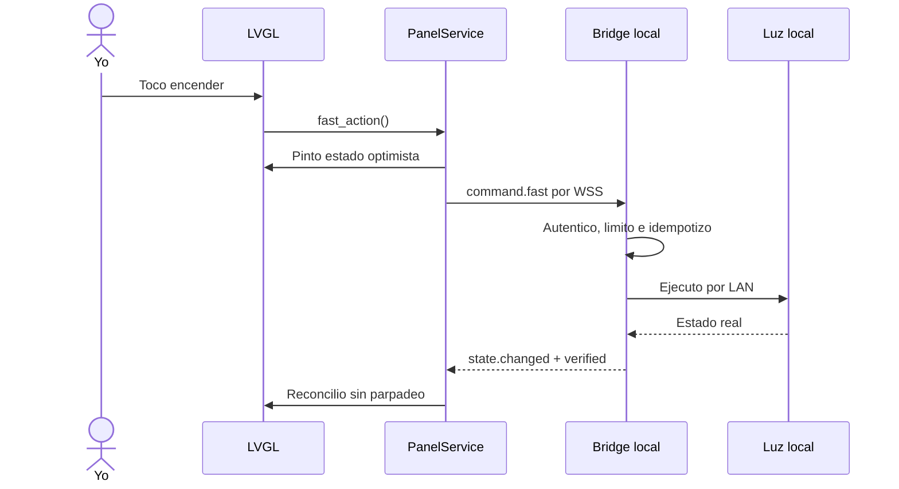
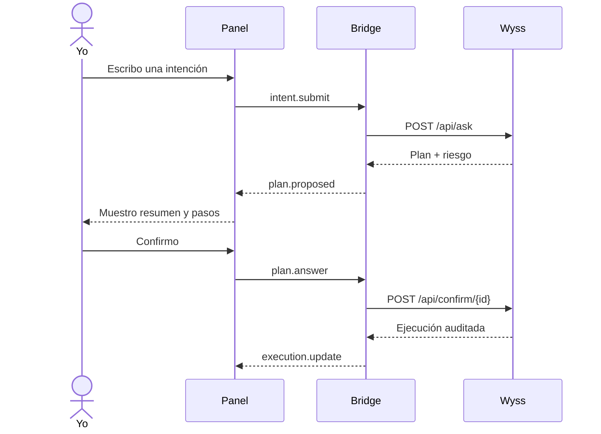
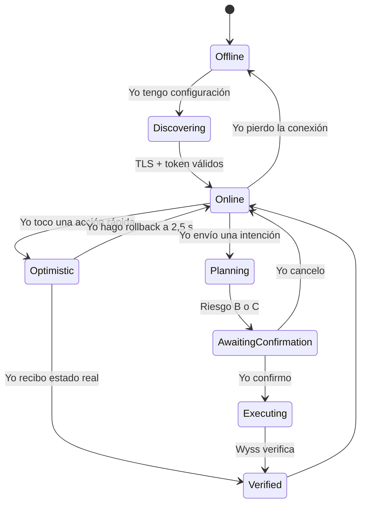
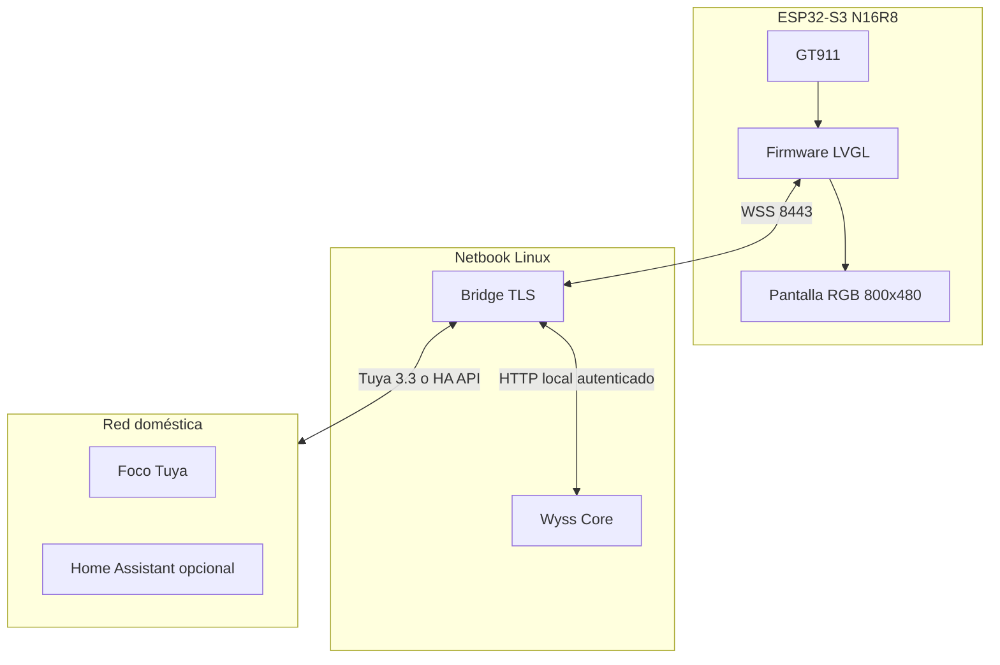

# Arquitectura

## Decisión

Yo uso arquitectura hexagonal para que la lógica del panel no dependa del hardware ni de los proveedores. Yo aplico SOLID separando una razón de cambio por adaptador, invirtiendo las dependencias hacia puertos pequeños y permitiendo reemplazar Tuya por Home Assistant sin modificar el dominio.

## UML de componentes

## UML de clases

## UML de secuencia rápida

## UML de secuencia orquestada

## UML de estados

## Despliegue

