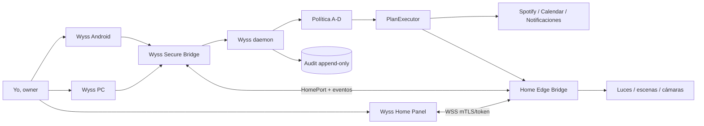
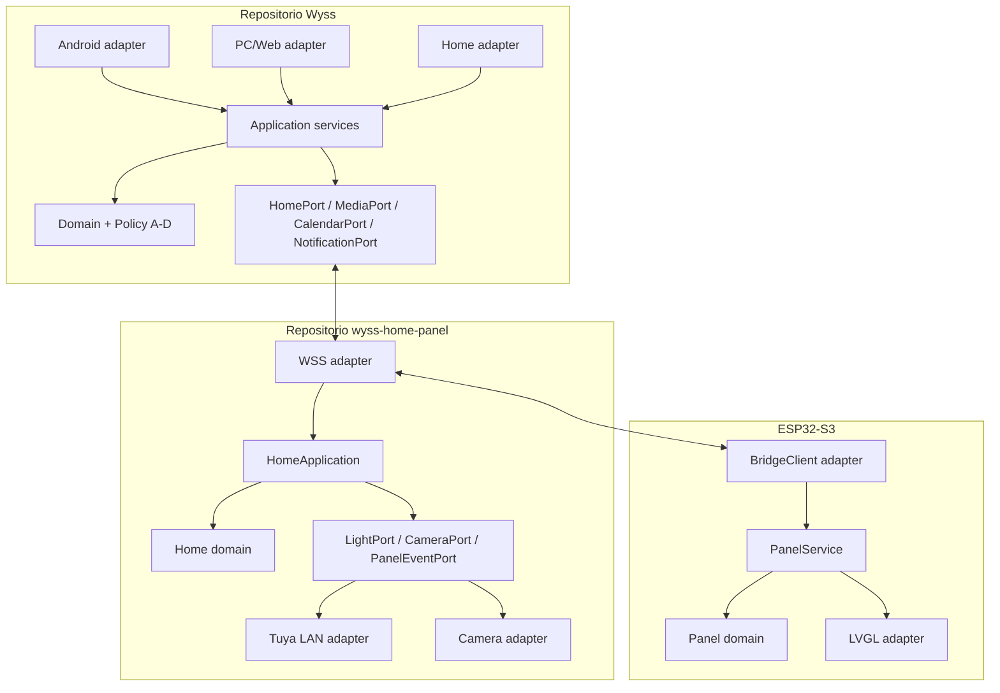
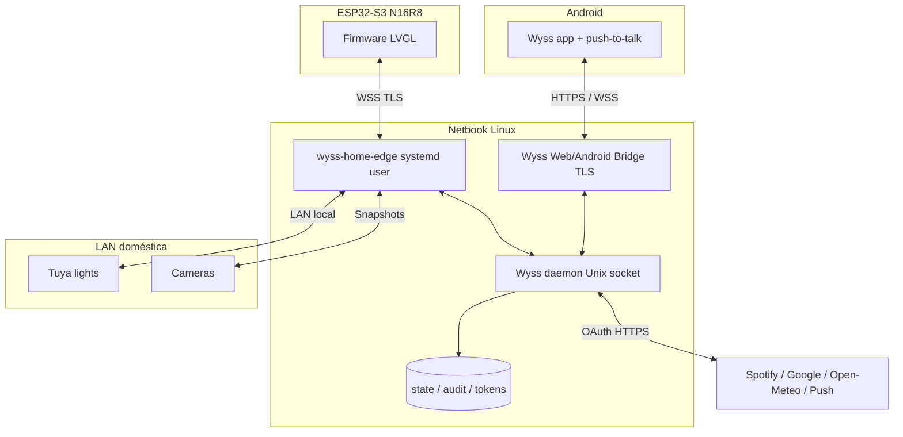
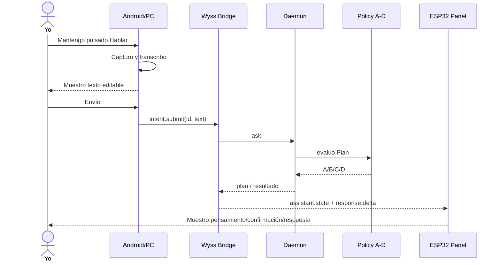
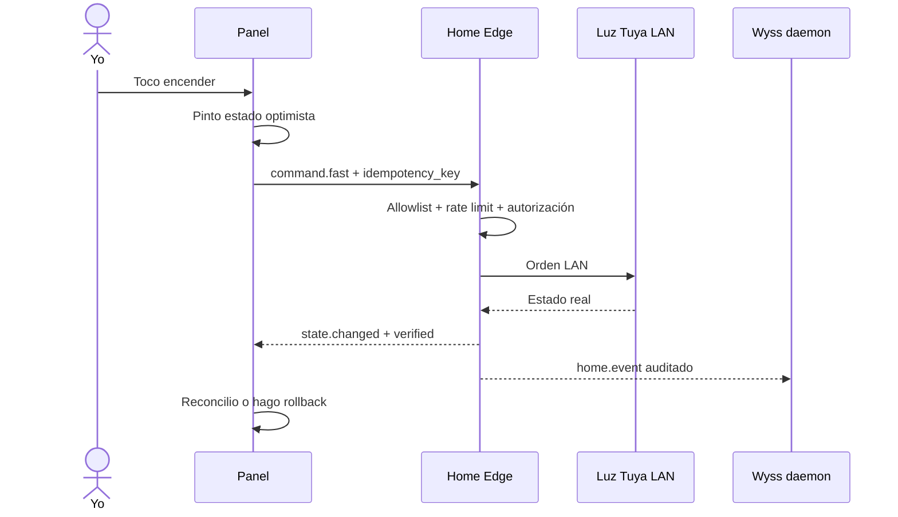
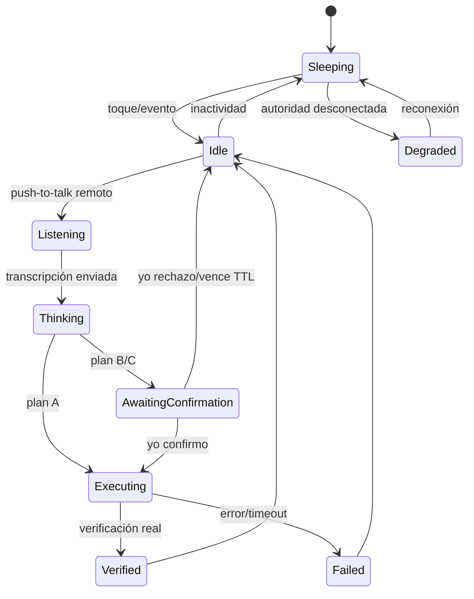

# Arquitectura end-to-end de Wyss Home v2.0.0

## Decisión principal

Yo preservo la arquitectura hexagonal de `SaintWyss/Wyss` y agrego un hexágono doméstico, no un segundo orquestador. Yo hago que PC, Android y pantalla sean clientes del mismo owner y que toda acción converja en el daemon, la política A–D y el executor auditado.

## Contextos delimitados

| Contexto | Responsabilidad que yo le asigno | Repositorio dueño |
| --- | --- | --- |
| Owner y conversación | Yo autentico, transcribo, mantengo sesión y presento respuestas. | `SaintWyss/Wyss` |
| Planificación y política | Yo creo planes, clasifico A–D, confirmo, ejecuto y audito. | `SaintWyss/Wyss` |
| Integraciones personales | Yo administro Spotify, Calendar, recordatorios y notificaciones. | `SaintWyss/Wyss` |
| Hogar | Yo normalizo luces, escenas, cámaras y estado doméstico. | `wyss-home-panel/edge` |
| Panel físico | Yo renderizo, recibo tacto y conservo el camino rápido autorizado. | `wyss-home-panel/firmware` |
| Baseline de hardware | Yo conservo evidencia y recuperación del control probado. | `esp32-smart-light-panel` |

## UML de contexto

## UML de componentes hexagonales

## Reglas de dependencia

1. Yo modifico el port antes de crear o modificar cualquier adapter.
2. Yo mantengo dominio C++ sin Arduino/LVGL y dominio Python sin FastAPI/httpx.
3. Yo dejo a los composition roots cablear dependencias sin decidir negocio.
4. Yo impido que firmware llame directamente a Google, Spotify o proveedores de IA.
5. Yo impido que Home Edge clasifique riesgo o confirme planes.
6. Yo impido que Android o PC envíen una acción doméstica fuera del mismo embudo.
7. Yo mantengo cada adapter reemplazable mediante contract tests.

## Topología de despliegue

Yo mantengo el control local dentro de la LAN. Si habilito acceso fuera del hogar, yo extiendo la red privada mediante Tailscale/WireGuard y mantengo cerrados los puertos públicos.

## Flujo de voz desde Android o PC

## Flujo rápido de luz

Yo limito este camino a acciones domésticas A reversibles y preautorizadas. Yo envío escenas amplias, Calendar, Spotify sensible y cualquier acción B/C al daemon antes de ejecutar.

## Máquina de estados del asistente

## Consistencia y concurrencia

Yo uso un modelo event-driven con snapshot inicial y deltas. Cada agregado tiene `revision`, cada comando tiene `request_id` y `idempotency_key`, y cada cliente conserva un `last_event_id`. Yo acepto entrega al menos una vez y hago idempotentes los consumidores. Yo no uso timestamps de máquinas distintas para ordenar; uso secuencias asignadas por la autoridad de cada agregado.

Yo resuelvo conflictos así:

- Yo dejo que el estado verificado del dispositivo gane sobre el estado optimista.
- Yo dejo que el primer `plan.answer` válido cierre el pendiente; los demás reciben `already_resolved`.
- Yo serializo comandos por `entity_id` para impedir carreras de brillo/encendido.
- Yo colapso sliders en una orden final y limito actualizaciones visuales locales.
- Yo reconstruyo la vista con snapshot si detecto un hueco de revisión.

## Degradación

| Falla | Comportamiento que yo diseño |
| --- | --- |
| Wyss daemon caído | Yo mantengo UI, clima cacheado y luces A locales; yo bloqueo planes y escrituras personales. |
| Home Edge caído | Yo muestro hogar no disponible y conservo conversación/Calendar/Spotify. |
| Internet caído | Yo mantengo luces, temporizadores locales y datos cacheados; yo marco nube desactualizada. |
| Panel desconectado | Yo mantengo PC/Android funcionales y sincronizo snapshot al volver. |
| Spotify/Google fallan | Yo aíslo el módulo y no degrado luces ni conversación. |
| Mensaje inválido | Yo rechazo fail-closed, audito metadatos sin contenido sensible y mantengo sesión. |

## Decisiones de repositorio

Yo no creo un repositorio por luz, Spotify, clima o Calendar. Yo uso módulos dentro del repositorio que posee el dominio. Yo creo un repositorio nuevo sólo si el servicio obtiene ciclo de vida, despliegue y consumidores independientes; una preferencia de organización no justifica distribución operacional.
