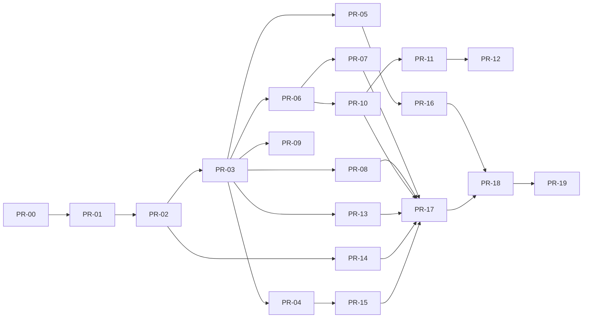

# Plan maestro 0 → Wyss Home v2.0.0 final

## Cómo ejecuto el plan

Yo trabajo por pull requests pequeños, verticales y reversibles. Yo escribo primero contrato/port y test, después dominio/application, luego adapter y composition root. Yo adjunto evidencia, actualizo trazabilidad y dejo rollback explícito en cada PR.

Yo no trato una fase temprana como MVP ni reduzco el alcance final. Yo uso alpha/beta/RC como niveles de evidencia del mismo producto completo.

## Línea base

Yo parto de:

- Wyss con orquestación, LLM, política A–D, pending TTL, executor, audit, PWA y Android;
- pantalla exacta con LVGL 8.4, doble framebuffer y mediciones físicas;
- luz LEDVANCE/Tuya LAN 3.3 funcionando;
- `wyss-home-panel` v1 con bridge TLS, arquitectura hexagonal y aprovisionamiento;
- backup de fábrica verificado fuera de Git.

## Workstreams

Yo coordino seis workstreams: contrato E2E, Wyss core, Home Edge, firmware/UX, Android/voz e infraestructura/calidad. Yo no paralelizo cambios que modifiquen el mismo contrato hasta congelar fixtures.

## PR-00 — Baseline reproducible y protección

**Objetivo:** yo congelo lo que funciona antes de evolucionar.

**Cambios:** yo documento versiones, capturo métricas, agrego fixtures v1, verifico backup/checksum, creo `doctor`, incorporo branch protection/CI completo y hago secret scan. Yo registro deuda real sin reescribir código.

**Aceptación:** yo reproduzco build firmware, tests Edge y smoke de luz real; yo guardo evidencia de 0,4 ms LVGL/touch y 22–41 ms Tuya o nuevas mediciones comparables.

**Rollback:** yo revierto sólo CI/docs; el firmware estable continúa disponible.

## PR-01 — Contratos y arquitectura v2

**Objetivo:** yo agrego ports y schemas sin adapters reales.

**Cambios:** yo creo `HomePort`, `ProjectionPort`, `ClientEventPort`, `MediaPort`, `CalendarPort`, `ReminderPort`, `TimerPort`, `NotificationPort`, `SpeechPort` y `CameraPort`. Yo agrego envelope v2, fixtures dorados Python/C++ y reglas import-linter.

**Aceptación:** yo valido todos los fixtures en ambos lenguajes, rechazo incompatibles y mantengo v1 intacto.

**Rollback:** yo retiro v2 porque ningún runtime depende todavía de él.

## PR-02 — Identidad, pairing y event backbone

**Objetivo:** yo conecto Wyss, Edge y panel con identidad por dispositivo y eventos reanudables.

**Cambios:** yo implemento CA/identidad, revocación, WSS, heartbeat, cursor, snapshot+deltas, idempotencia, rate limit y observabilidad. Yo integro Home Edge con el daemon mediante adapter, nunca con acceso directo al executor.

**Aceptación:** yo demuestro reconnect, replay seguro, revocación inmediata, 1.000 reconexiones y compatibilidad v1 durante migración.

**Rollback:** yo conservo listener v1 y desactivo feature flag v2.

## PR-03 — Projection Store y sincronización multicliente

**Objetivo:** yo doy a PC, Android y panel una vista coherente.

**Cambios:** yo creo reducers por agregado, revisión, snapshot, delta, conflict resolution y cache acotado. Yo publico cambios desde una acción iniciada en cualquiera de los tres clientes.

**Aceptación:** yo cambio luz/estado simulado desde cada cliente y observo convergencia sin duplicación ni polling agresivo.

**Rollback:** yo vuelvo a snapshots periódicos detrás de feature flag sin perder autoridad.

## PR-04 — Shell visual Wyss Core y modo dormido

**Objetivo:** yo entrego la identidad visual final sobre datos simulados.

**Cambios:** yo implemento design tokens, navegación, núcleo/estados, idle 5–10 FPS, modo manual, cards responsivas, accesibilidad, screenshot tests y simulador LVGL.

**Aceptación:** yo mantengo ≥30 FPS interactivo, ≤50 ms tacto→paint, objetivos ≥44 px, RAM/Flash dentro de presupuesto y revisión visual aprobada.

**Rollback:** yo mantengo la UI v1 seleccionable por build flag hasta beta.

## PR-05 — Luces completas y migración del baseline

**Objetivo:** yo convierto el control probado en un adapter de producción.

**Cambios:** yo migro Tuya LAN detrás de `LightPort`, agrego múltiples luces, color, escenas, disponibilidad, serialización por entidad, optimismo, rollback, audit y adapter Home Assistant opcional.

**Aceptación:** yo pruebo 500 cambios, caída de Wi-Fi, clave inválida, foco offline, control desde Android/PC/panel y p95 ≤150 ms en LAN.

**Rollback:** yo vuelvo al adapter/binary estable sin cambiar credenciales ni NVS.

## PR-06 — Conversación visual y confirmaciones

**Objetivo:** yo hago que la pantalla sea la presencia de Wyss.

**Cambios:** yo proyecto streaming de respuesta, estados, pending B/C, TTL, primera confirmación válida, gate `CONFIRMAR`, errores y modo degradado. Yo mantengo historial completo sólo en Wyss.

**Aceptación:** yo ejecuto A, B, C, D desde tres clientes; yo demuestro re-evaluación, carrera segura y ningún bypass.

**Rollback:** yo desactivo streaming y uso respuestas completas manteniendo policy.

## PR-07 — Push-to-talk PC y Android

**Objetivo:** yo incorporo voz como entrada y texto como salida en pantalla.

**Cambios:** yo implemento permisos, botón hold-to-talk, captura, transcripción local-first, edición previa, cancelación, estados y limpieza de audio. Yo no agrego wake word ni TTS.

**Aceptación:** yo pruebo micrófono PC y Android físico, permisos negados, interrupción, silencio, ruido, proveedor caído y eliminación del buffer.

**Rollback:** yo conservo texto como path principal y desactivo voz por config.

## PR-08 — Spotify Premium

**Objetivo:** yo controlo media desde cualquier cliente.

**Cambios:** yo implemento OAuth/scopes, refresh/revocation, playback state, dispositivos, play/pause, anterior/siguiente, volumen y favoritos. Yo proyecto al panel sin token.

**Aceptación:** yo pruebo cuenta real Premium, token vencido, 204, 401, 429, dispositivo inactivo y sincronización multicliente.

**Rollback:** yo revoco OAuth y oculto módulo sin afectar shell.

## PR-09 — Clima semanal

**Objetivo:** yo muestro clima actual y siete días para Resistencia.

**Cambios:** yo implemento `WeatherPort`, provider, cache, códigos normalizados, antigüedad y presentación idle/manual.

**Aceptación:** yo pruebo online, offline, cache vencido, timezone, valores faltantes y tráfico dentro de presupuesto.

**Rollback:** yo conservo el último cache u oculto la card con estado explícito.

## PR-10 — Google Calendar

**Objetivo:** yo consulto y administro agenda desde Wyss.

**Cambios:** yo implemento OAuth/scopes separados, incremental sync, timezone/all-day/recurrencia, CRUD, plan/policy y proyección diaria/semanal.

**Aceptación:** yo creo, edito y elimino evento real; pruebo token vencido, sync invalidado, paginación, recurrencia y confirmación B/C.

**Rollback:** yo revoco write scope y mantiene lectura/cache.

## PR-11 — Recordatorios y notificaciones Android

**Objetivo:** yo creo recordatorios durables y los entrego al celular.

**Cambios:** yo agrego dominio, recurrencia, completar/snooze, scheduler, canales Android, deduplicación, deep links y proyección en pantalla.

**Aceptación:** yo reinicio host, cambio zona horaria, pierdo conectividad y recibo una notificación única al recuperar; yo pruebo permisos negados.

**Rollback:** yo mantengo el recordatorio en Wyss y desactivo push sin perder datos.

## PR-12 — Temporizadores durables

**Objetivo:** yo opero timers desde PC, Android y panel.

**Cambios:** yo implemento create/pause/resume/cancel, presets, persistencia, deadline monotónico, recovery UTC y `timer.completed` idempotente.

**Aceptación:** yo reinicio procesos/panel, creo 100 timers, pruebo reloj del sistema y recibo una sola notificación Android.

**Rollback:** yo exporto timers activos, vuelvo al scheduler anterior y reimporto.

## PR-13 — Cámaras

**Objetivo:** yo completo el módulo al llegar el hardware.

**Cambios:** yo identifico modelo/protocolo, implemento adapter local, health, snapshot efímero redimensionado, auth en Edge, vista única, límites y privacy shutter lógico si existe.

**Aceptación:** yo pruebo cámara real, credencial inválida, offline, timeout, snapshot, no-retención, SSRF y ausencia de credenciales en firmware/logs.

**Rollback:** yo revoco credencial, deshabilita adapter y conserva shell estable.

## PR-14 — Acceso remoto privado y operación móvil

**Objetivo:** yo permito control fuera de la LAN sin exponer servicios.

**Cambios:** yo documento y automatizo Tailscale o WireGuard, ACL por dispositivo, DNS privado, revocación, deep links y health. Yo no activo port forwarding.

**Aceptación:** yo pruebo Wi-Fi doméstico, datos móviles, pérdida de VPN, dispositivo revocado y ninguna escucha pública mediante scan externo.

**Rollback:** yo deshabilita VPN ACL y vuelve a LAN-only.

## PR-15 — OTA, provisioning y recovery de producción

**Objetivo:** yo actualizo sin convertir la pantalla en un punto frágil.

**Cambios:** yo agrego firmware firmado, particiones A/B, manifest, health boot, rollback, tool de provisioning idempotente, backup/restore y migración de config.

**Aceptación:** yo pruebo imagen válida, corrupta, firma inválida, corte de energía, rollback y rescue USB en placa real.

**Rollback:** yo uso USB y restauro una imagen conocida; los eFuses permanecen sin tocar.

## PR-16 — Observabilidad, rendimiento y sostenibilidad

**Objetivo:** yo demuestro presupuestos finales.

**Cambios:** yo agrego métricas, traces correlacionadas, panel doctor, backpressure, cache tuning, idle FPS/brillo, alertas y runbooks.

**Aceptación:** yo entrego un reporte p50/p95/p99, consumo, RAM/Flash, tráfico idle, aislamiento de fallas y ausencia de secretos.

**Rollback:** yo desactivo telemetry no crítica y conservo health básico.

## PR-17 — Hardening y suite adversarial

**Objetivo:** yo cierro la superficie doméstica antes de release.

**Cambios:** yo ejecuto threat model, fuzz, replay, SSRF, injection, carreras, revocación, dependency/SBOM/secret scan y revisión de scopes. Yo agrego una segunda muralla específica de hogar.

**Aceptación:** yo cierro todos los hallazgos altos/críticos y documento los restantes con owner/riesgo/fecha.

**Rollback:** yo mantengo controles aditivos; si un cambio rompe operación, yo revierto funcionalidad, no el control esencial.

## PR-18 — Beta diaria y soak

**Objetivo:** yo uso el producto completo como sistema diario.

**Cambios:** yo congelo features, ejecuto 72 h soak, 1.000 reconexiones, fault injection, upgrade desde v1, restore y matriz E2E real. Yo corrijo sólo defects.

**Aceptación:** yo obtengo cero crash/watchdog, cero estado falso, cero duplicación de timer/notification y todos los presupuestos aprobados.

**Rollback:** yo vuelvo a la release candidata anterior con datos preservados.

## PR-19 — Release v2.0.0 final

**Objetivo:** yo promuevo el commit probado.

**Cambios:** yo actualizo versiones, compatibilidad, changelog, operator guide, límites, checksums, SBOM, firmas, artefactos y tag. Yo repito smoke en PC, Android, panel, luz, Spotify, Calendar, clima, timer, reminder, push y cámara.

**Aceptación:** yo completo la trazabilidad al 100 %, CI verde, smoke físico firmado, rollback ensayado y ninguna excepción oculta.

**Rollback:** yo publico instrucciones de downgrade y conservo artefactos v1/RC.

## Dependencias

Yo puedo desarrollar integraciones PR-08/09/10 en paralelo después de PR-03, pero yo las integro una por vez y mantengo trunk verde.

## Definición de Done por PR

Yo exijo scope cerrado, ADR si cambia decisión, port antes de adapter, tests, type/static checks, seguridad, documentación, telemetría necesaria, migración, rollback probado, evidencia y actualización de trazabilidad. Yo no acepto TODO silencioso ni “funciona en mi máquina”.

## Cadencia y control

Yo no fijo fechas artificiales sin medir capacidad. Yo limito WIP a un PR de contrato y dos adapters independientes. Yo hago demo física al cerrar cada bloque de hardware y no acumulo integración para el final.
