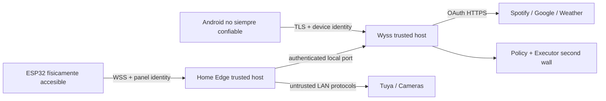

# Modelo de amenazas de Wyss Home v2.0.0

## Objetivo

Yo protejo a un único owner, su hogar, agenda, cuentas, cámaras y dispositivos frente a atacantes de red, dispositivos robados, proveedores comprometidos, errores del modelo y fallos operativos. Yo reutilizo la política A–D, la denylist inamovible, la re-evaluación y la segunda muralla de Wyss.

## Activos

Yo protejo claves Tuya, OAuth Google/Spotify, credenciales de cámara, identidades TLS, sesión Android, conversación, agenda, audio transitorio, snapshots, presencia, historial de acciones, firmware y configuración.

## Límites de confianza

Yo trato Android y ESP32 como clientes revocables, la LAN como hostil, contenido de proveedores como no confiable y planes del LLM como propuestas sin autoridad.

## Amenazas y controles

| Amenaza | Control que yo exijo |
| --- | --- |
| Robo/replay de token del panel | Yo uso token aleatorio por dispositivo, hash server-side, TLS, nonce de sesión, idempotencia, rotación y revocación. |
| Panel extraído físicamente | Yo no almaceno OAuth ni credenciales de cámara; yo documento riesgo NVS y planifico flash encryption/Secure Boot sólo tras recovery probado. |
| Android perdido | Yo uso keystore, bloqueo del SO, token por dispositivo, revocación y sesiones acotadas. |
| MITM/DNS rebinding | Yo uso TLS, pinning/CA local, Host/Origin allowlist y VPN para remoto. |
| LLM alucina acción | Yo valido schema, aplico política determinista, denylist D, confirmación y segunda muralla. |
| Prompt injection desde Calendar/cámara/media | Yo marco contenido externo como untrusted, lo minimizo y nunca lo convierto en instrucción ejecutable. |
| Carrera de confirmaciones | Yo uso revisión CAS y primera respuesta válida; yo reevalúo política al confirmar. |
| Comando duplicado | Yo uso idempotency key y cache durable. |
| SSRF mediante URL de cámara/calendar | Yo configuro endpoints administrativamente, bloqueo rangos/redirects inesperados y no acepto URLs desde intents sin gate C. |
| Fuga por logs | Yo redacto tokens, audio, headers, URLs privadas y payloads sensibles; yo testeo redacción. |
| Firmware malicioso | Yo genero artefacto reproducible, checksum, firma, OTA A/B y rollback. |
| DoS de red/UI | Yo aplico límite de mensaje, rate limit, backpressure, colas acotadas y aislamiento de tareas. |
| Proveedor comprometido | Yo aplico scopes mínimos, validación estricta, cache y revocación independiente. |
| Cámara expuesta | Yo mantengo acceso local, credencial sólo en Edge, snapshot efímero y sin port forwarding. |

## Autorización

Yo emito identidad distinta para Android, PC y cada panel. Yo asigno capabilities explícitas:

- `panel.read_projection`;
- `panel.light.fast` limitado a entidades allowlisted;
- `panel.submit_intent`;
- `panel.answer_plan` sólo con sesión física activa;
- `android.submit_intent`, `android.answer_plan`, `android.voice`;
- `edge.device.execute` y `edge.publish_state`.

Yo no uso una credencial compartida para todos los clientes. Yo niego por default y audito denegaciones sin exponer secreto.

## Política por capacidad

| Acción | Nivel base que yo propongo |
| --- | --- |
| Leer estado, clima, agenda | A |
| Encender/apagar una luz allowlisted | A con camino rápido y audit |
| Cambiar brillo/color individual | A con límites |
| Cambiar reproducción Spotify | A/B según contexto y dispositivo |
| Crear/editar evento o recordatorio | B |
| Eliminar uno | B o C según impacto |
| Acción masiva/recurrencia amplia | C |
| Desactivar seguridad, exponer cámara, borrar auditoría | D |

Yo trato esta tabla como baseline; el engine puede elevar, nunca reducir reglas built-in.

## Secretos

Yo guardo secretos de host en archivos 0600 o secret store del SO. Yo guardo tokens Android en Keystore. Yo guardo sólo material mínimo del panel en NVS y preparo migración a cifrado. Yo nunca guardo secretos en TOML público, firmware generado, QR persistente, backup publicado o capturas de documentación.

Yo diseño rotación sin reinstalar todo el sistema: credencial nueva, overlap corto, revocación de anterior y verificación. Yo documento procedimiento de dispositivo perdido.

## Voz y privacidad

Yo sólo grabo durante push-to-talk. Yo muestro indicador inequívoco. Yo borro audio tras transcribir y conservo texto únicamente según la política de conversación. Yo no activo escucha ambiental, wake word ni grabación desde el ESP32.

## Respuesta a incidentes

1. Yo aíslo el dispositivo o adapter afectado.
2. Yo revoco su identidad y tokens.
3. Yo conservo auditoría y evidencia sin copiar secretos.
4. Yo comparo firmware/config contra checksums conocidos.
5. Yo roto credenciales relacionadas.
6. Yo restauro versión firmada y snapshot seguro.
7. Yo documento causa, impacto y prueba de no repetición.

## Gates de seguridad

Yo no libero v2.0.0 sin suite de mensajes maliciosos, replay, expiración, carreras, SSRF, prompt injection, redacción, revocación, rollback OTA y pruebas físicas de pairing. Yo ejecuto análisis de dependencias, SBOM, secret scan y revisión manual del diff de políticas.
